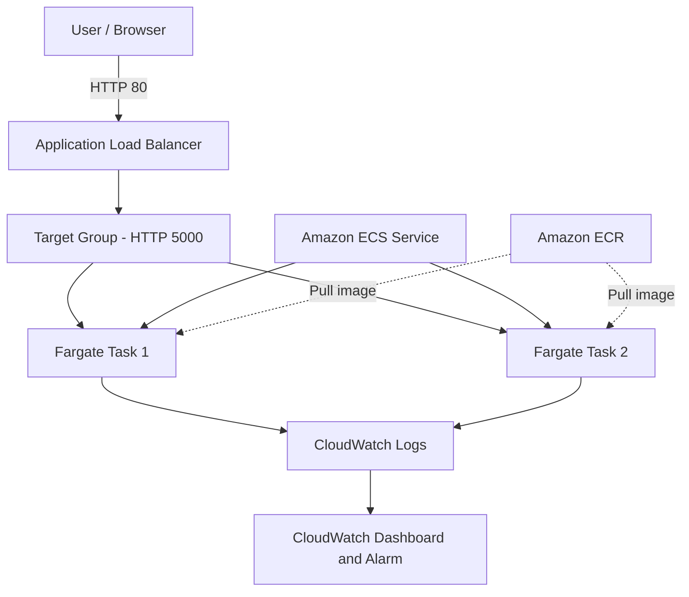

# ECS Fargate Web App

Container hóa ứng dụng web Flask bằng Docker và triển khai trên Amazon ECS Fargate, sử dụng Amazon ECR, Application Load Balancer và Amazon CloudWatch.

## 1. Project Overview

Đề tài: Container hóa ứng dụng web và triển khai lên Amazon ECS Fargate.

- Môn học: Cloud - Dot 1 - 2026–2027
- Nhóm: Containers
- Giảng viên hướng dẫn: Huỳnh Xuân Phụng
- AWS Region: us-east-1 (N. Virginia)
- Ngôn ngữ: Python 3.13
- Framework: Flask
- Application server: Gunicorn

## 2. Architecture



## 3. AWS Resources

| Component | Resource |
|---|---|
| Region | us-east-1 |
| VPC | Default VPC |
| ECR Repository | ecs-fargate-web-app |
| ECS Cluster | ecs-fargate-web-app-cluster |
| ECS Service | ecs-fargate-web-app-service |
| Task Definition | ecs-fargate-web-app-task:2 |
| Launch type | AWS Fargate |
| CPU | 0.25 vCPU |
| Memory | 0.5 GiB |
| Network mode | awsvpc |
| Container port | 5000 |
| Task role | LabRole |
| Task execution role | LabRole |
| ALB | ecs-fargate-web-app-alb |
| Target Group | ecs-fargate-web-app-tg |
| Listener | HTTP:80 |

## 4. Application Features

The Flask application provides:

- Homepage: `/`
- Health check endpoint: `/health`

Expected health check response:

```json
{"status": "healthy"}
```

## 5. Docker Configuration

The Dockerfile uses a multi-stage build:

- Builder stage installs Python dependencies.
- Runtime stage copies installed dependencies and application source code.
- Gunicorn runs the Flask application.
- The container runs as a non-root user named `appuser`.
- Application logs are written to stdout and stderr.
- Application port: 5000.

Base image: `python:3.13-slim`.

## 6. Build and Run Locally

Build the Docker image:

```bash
docker build -t ecs-fargate-web-app:week1 .
```

Run the container:

```bash
docker run -d --name ecs-web-test -p 5000:5000 ecs-fargate-web-app:week1
```

Test the health endpoint:

```bash
curl http://localhost:5000/health
```

## 7. Build Image on AWS CloudShell

The project image was also built and tested directly in AWS CloudShell.

Build command:

```bash
docker build -t ecs-fargate-web-app:week4-cloudshell .
```

The container was tested using:

```bash
curl -i http://localhost:5000/health
```

The test returned HTTP 200 and:

```json
{"status": "healthy"}
```

The image was subsequently pushed to Amazon ECR with tag `week4-cloudshell`.

## 8. Amazon ECR

Repository: `ecs-fargate-web-app`

Verified image tags:

- `week1`
- `week4-cloudshell`

The `week4-cloudshell` image was built on AWS CloudShell and pushed successfully on November 4, 2026.

The ECS Service continued using Task Definition Revision 2 and the existing `week1` image. The new image was not used to replace the running service configuration.

## 9. Amazon ECS and AWS Fargate

The ECS Service was tested with:

- Desired tasks: 2
- Running tasks: 2
- Pending tasks: 0
- Deployment status: Success
- Healthy targets: 2

After testing, the service was scaled to zero to reduce Fargate compute charges.

Final service state:

- Desired tasks: 0
- Running tasks: 0
- Pending tasks: 0

## 10. Application Load Balancer

The Application Load Balancer receives HTTP requests on port 80 and forwards them to the Target Group.

Target Group configuration:

- Protocol: HTTP
- Port: 5000
- Health check path: `/health`

Two registered targets were verified as Healthy during the final system test.

## 11. Security Groups

Two separate Security Groups are used.

ALB Security Group:

- Name: `ecs-fargate-web-app-alb-sg`
- Inbound: HTTP TCP port 80 from `0.0.0.0/0`

ECS Task Security Group:

- Name: `ecs-fargate-web-app-task-sg`
- Inbound: TCP port 5000 from the ALB Security Group.

This configuration restricts direct access to the application container.

## 12. Amazon CloudWatch

CloudWatch Log Group:

- Name: `/ecs/ecs-fargate-web-app-task`
- Retention: 30 days
- Log stream prefix: `ecs`

CloudWatch Dashboard:

- Name: `ECS-Fargate-Monitoring`
- ECS CPU utilization
- ECS Memory utilization
- ALB HealthyHostCount
- ALB UnHealthyHostCount
- ALB RequestCount

CloudWatch Alarm:

- Name: `ECS-Fargate-UnHealthyHost-Alarm`
- Metric: `UnHealthyHostCount`
- Condition: Greater than 0
- Evaluation: 2 datapoints within 10 minutes
- Verified state: OK

## 13. Amazon S3

An S3 bucket was created for project document storage:

`ecs-fargate-web-app-evidence-729012882197-20261104`

Configuration:

- Region: us-east-1
- Block Public Access: Enabled
- Default encryption: SSE-S3 (AES256)
- Project tag: `ECSFargateWebApp`
- Owner tag: `Do Le Gia Han`

The bucket is private and is not part of the application's HTTP request path.

## 14. Cost Optimization

The project applies the following cost-management practices:

- Scale ECS Service to zero when not in use.
- Remove temporary test containers after testing.
- Configure CloudWatch Logs retention to 30 days.
- Review unused AWS resources before cleanup.
- Preserve required evidence before deleting resources.

On November 4, 2026, the Learner Lab displayed $9.40 used out of a $50.00 budget. This represents overall Lab usage and is not an isolated cost measurement for this project.

## 15. Repository Structure

```text
ecs-fargate-web-app/
├── app/
│   ├── app.py
│   └── templates/
│       └── index.html
├── evidence/
│   ├── week1/
│   ├── week2/
│   ├── week3/
│   └── week4/
├── reports/
│   ├── weekly-report-week1.md
│   ├── weekly-report-week2.md
│   ├── weekly-report-week3.md
│   └── weekly-report-week4.md
├── Dockerfile
├── requirements.txt
├── .dockerignore
├── .gitignore
└── README.md
```

## 16. Evidence and Reports

Project screenshots and documentation are maintained in:

- `evidence/week1/`
- `evidence/week2/`
- `evidence/week3/`
- `evidence/week4/`
- `reports/`

The weekly reports document implementation progress, AWS configuration, testing results and supporting evidence.

## 17. Project Repository

GitHub:

https://github.com/24110208-rgb/ecs-fargate-web-app
