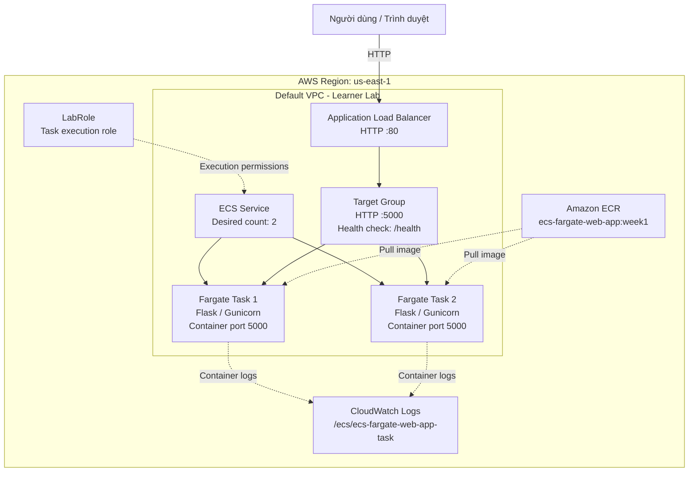
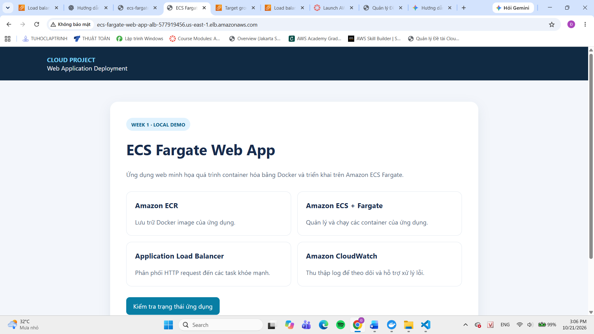

# BÁO CÁO TIẾN ĐỘ TUẦN 1

## Đề tài: Container hóa ứng dụng web và triển khai lên Amazon ECS Fargate

## 1. Thông tin đề tài

| Thông tin | Nội dung |
|---|---|
| Tên đề tài | Container hóa ứng dụng web và triển khai lên Amazon ECS Fargate |
| Môn học | Cloud – Dot 1 – Năm học 2026–2027 |
| Giảng viên hướng dẫn | Huỳnh Xuân Phụng |
| Nhóm | Containers |
| Thành viên | Đỗ Lê Gia Hân |
| Người phụ trách Tuần 1 | Đỗ Lê Gia Hân |
| Thời gian báo cáo | Tuần 1; triển khai AWS ngày 21/10/2026 |
| AWS Region | `us-east-1` – US East (N. Virginia) |
| Repository Git | https://github.com/24110208-rgb/ecs-fargate-web-app |
| Nhánh chính | `main` |
| Commit mã nguồn đã ghi nhận | [`7b46a55`](https://github.com/24110208-rgb/ecs-fargate-web-app/commit/7b46a550590707dfc2a15edca25f0fc7bdd754e7) |
| Tổng thời gian làm việc | 10 giờ |
| Trạng thái chung | Đã triển khai ứng dụng thử nghiệm trên AWS; đang hoàn thiện tài liệu và rà soát bảo mật |

**Phạm vi phụ trách:** Trong Tuần 1, em là Đỗ Lê Gia Hân, trực tiếp thực hiện toàn bộ công việc của dự án, bao gồm phát triển ứng dụng, container hóa bằng Docker, quản lý mã nguồn, triển khai AWS, kiểm thử, xử lý lỗi và thu thập minh chứng.

## 2. Mục tiêu tuần 1

Trong tuần 1, em tập trung xây dựng ứng dụng web mẫu, container hóa ứng dụng bằng Docker, quản lý mã nguồn trên GitHub và triển khai ứng dụng thử nghiệm lên Amazon ECS sử dụng AWS Fargate.

Các mục tiêu cụ thể:

- Xây dựng ứng dụng web bằng Python và Flask, có trang chủ và endpoint kiểm tra sức khỏe `/health`.
- Xây dựng Docker image bằng Dockerfile multi-stage, sử dụng Gunicorn để chạy ứng dụng.
- Quản lý mã nguồn bằng Git và GitHub.
- Tạo Amazon ECR repository và đẩy Docker image lên AWS.
- Tạo ECS cluster, Task Definition và ECS Service sử dụng AWS Fargate.
- Cấu hình Application Load Balancer để truy cập ứng dụng qua HTTP.
- Thiết lập CloudWatch Logs để thu thập log truy cập từ container.
- Kiểm tra hoạt động thực tế của ứng dụng sau khi triển khai.
- Thu thập ảnh minh chứng phục vụ báo cáo tiến độ.
- Xác định những phần cần tiếp tục hoàn thiện, bao gồm sơ đồ kiến trúc, bảo mật, quy ước tag AWS và worklog.

Kết quả thực tế vượt qua phạm vi chuẩn bị môi trường ban đầu: em đã triển khai được ứng dụng lên AWS và truy cập thành công thông qua DNS của Application Load Balancer.

## 3. Tiến độ công việc tuần 1

| STT | Công việc | Kết quả thực tế | Người phụ trách | Trạng thái | Minh chứng |
|---:|---|---|---|---|---|
| 1 | Phân tích yêu cầu đề tài | Xác định phạm vi ứng dụng container, lưu trữ image, chạy Fargate, cân bằng tải và thu thập log | Đỗ Lê Gia Hân | Hoàn thành | Báo cáo tiến độ |
| 2 | Tìm hiểu dịch vụ AWS | Đã sử dụng ECR, ECS, Fargate, ALB và CloudWatch trong quá trình triển khai | Đỗ Lê Gia Hân | Hoàn thành phần triển khai thực tế | Ảnh AWS Console |
| 3 | Lựa chọn công nghệ web | Chọn Python, Flask và Gunicorn; xây dựng endpoint `/` và `/health` | Đỗ Lê Gia Hân | Hoàn thành | Mã nguồn GitHub |
| 4 | Tạo repository Git | Đã push mã nguồn lên GitHub và đồng bộ nhánh `main` | Đỗ Lê Gia Hân | Hoàn thành | Repository GitHub |
| 5 | Thiết kế kiến trúc AWS | Đã xác định luồng ECR, ECS Fargate, ALB và CloudWatch; tiếp tục hoàn thiện sơ đồ riêng | Đỗ Lê Gia Hân | Đang hoàn thiện tài liệu | Mục 5 |
| 6 | Thiết kế mạng VPC | Đã sử dụng default VPC và các subnet có sẵn trong Learner Lab | Đỗ Lê Gia Hân | Đã cấu hình cơ bản | Ảnh Networking/Security Groups |
| 7 | Kiểm tra và sử dụng IAM LabRole | Đã sử dụng `LabRole` làm task execution role | Đỗ Lê Gia Hân | Hoàn thành phần sử dụng role | Ảnh Task Definition |
| 8 | Chuẩn bị S3 | Chưa tạo S3 bucket vì chưa xác nhận yêu cầu bắt buộc | Đỗ Lê Gia Hân | Chưa thực hiện | Cần kiểm tra yêu cầu môn học |
| 9 | Lập quy ước tag AWS | Đã xác định các tag đề xuất; chưa gắn tag thực tế lên tài nguyên | Đỗ Lê Gia Hân | Chưa hoàn thành | Mục 7 |
| 10 | Kiểm thử ứng dụng và Docker | Đã build image, kiểm thử cục bộ và push image lên ECR | Đỗ Lê Gia Hân | Hoàn thành | Ảnh Docker/ECR |
| 11 | Triển khai ECS Fargate | Đã tạo cluster, Task Definition và Service với hai tasks mong muốn | Đỗ Lê Gia Hân | Đã triển khai | Ảnh ECS Service |
| 12 | Kiểm tra CloudWatch Logs | Đã thấy các yêu cầu health check với mã HTTP 200 | Đỗ Lê Gia Hân | Đã kiểm tra thực tế | Ảnh CloudWatch Logs |

**Quy ước trạng thái:** `Chưa thực hiện`, `Đang thực hiện`, `Hoàn thành` hoặc `Bị chặn`. Trạng thái chỉ phản ánh công việc đã thực hiện và có thể kiểm chứng.

### 3.1. Tìm hiểu và sử dụng các dịch vụ AWS

| Dịch vụ | Vai trò trong đề tài | Kết quả thực tế |
|---|---|---|
| Amazon ECR | Lưu trữ Docker image | Đã tạo repository `ecs-fargate-web-app` và push tag `week1` thành công |
| Amazon ECS | Quản lý cluster, Task Definition và Service | Đã tạo cluster và service |
| AWS Fargate | Chạy container mà không cần quản lý EC2 host | Đã triển khai hai tasks theo cấu hình service |
| Application Load Balancer | Tiếp nhận request và phân phối đến các task | Đã tạo ALB, listener HTTP port 80 và target group port 5000 |
| Amazon CloudWatch Logs | Thu thập log ứng dụng | Đã ghi nhận log `GET /health` với mã phản hồi HTTP 200 |
| Amazon VPC | Cung cấp mạng cho tài nguyên AWS | Đã sử dụng default VPC và các subnet có sẵn |
| Security Groups | Kiểm soát lưu lượng mạng | Đã cấu hình HTTP port 80 và TCP port 5000; cần tiếp tục rà soát bảo mật |
| IAM LabRole | Cung cấp quyền phục vụ chạy task | Đã chọn làm task execution role |
| Amazon S3 | Lưu tài liệu hoặc minh chứng nếu cần | Chưa tạo bucket; cần xác nhận yêu cầu môn học |

### 3.2. Kết quả tìm hiểu và kiểm chứng

Qua quá trình triển khai, em đã thực hiện và kiểm chứng các nội dung sau:

- Amazon ECR lưu trữ Docker image để ECS có thể lấy image khi khởi chạy container.
- Task Definition mô tả image, cổng ứng dụng, CPU, bộ nhớ và cấu hình log.
- ECS Service quản lý các task và duy trì số lượng task mong muốn.
- AWS Fargate chạy container mà không yêu cầu tự quản lý máy chủ EC2.
- Application Load Balancer nhận request HTTP và chuyển request đến các task thông qua target group.
- Health check tại `/health` được sử dụng để kiểm tra trạng thái ứng dụng.
- CloudWatch Logs lưu lại request health check, hỗ trợ theo dõi hoạt động của container.
- Security group kiểm soát lưu lượng giữa ALB và các task.
- `LabRole` được sử dụng theo cơ chế quyền của Learner Lab, không đồng nghĩa với quyền quản trị AWS toàn phần.
- Amazon S3 không bắt buộc phải nằm trong luồng xử lý request của ứng dụng nếu đề tài không yêu cầu sử dụng S3.

**Kết quả kiểm chứng:** Ứng dụng trả về `{"status":"healthy"}` khi truy cập endpoint `/health` thông qua DNS của ALB. CloudWatch Logs ghi nhận các request `GET /health` với mã phản hồi HTTP 200.

### 3.3. Tổng kết tiến độ tuần 1

**Công việc đã hoàn thành:**

- Xây dựng ứng dụng web bằng Flask.
- Xây dựng Dockerfile multi-stage và file `.dockerignore`.
- Build Docker image `ecs-fargate-web-app:week1`.
- Kiểm tra endpoint `/health` trên máy tính cá nhân.
- Push mã nguồn lên GitHub.
- Tạo Amazon ECR repository và push image lên AWS.
- Tạo ECS cluster `ecs-fargate-web-app-cluster`.
- Tạo Task Definition `ecs-fargate-web-app-task:1`.
- Tạo ECS Service `ecs-fargate-web-app-service`.
- Cấu hình AWS Fargate với số lượng mong muốn hai tasks.
- Tạo Application Load Balancer `ecs-fargate-web-app-alb`.
- Truy cập thành công trang chủ và endpoint `/health` qua DNS của ALB.
- Kiểm tra CloudWatch Logs và xác nhận các log health check có mã HTTP 200.
- Thu thập ảnh minh chứng cho các bước triển khai chính.

**Công việc đang hoàn thiện:**

- Hoàn thiện sơ đồ kiến trúc AWS thành tài liệu riêng.
- Xác nhận trạng thái mới nhất của hai targets sau các thay đổi Security group.
- Rà soát bảo mật giữa ALB và ECS tasks.
- Hoàn thiện quy ước và việc gắn AWS resource tags.
- Kiểm tra yêu cầu S3 theo nội dung môn học.
- Hoàn thiện worklog và sắp xếp ảnh minh chứng.
- Cập nhật README và báo cáo trên GitHub nếu cần.

**Khó khăn và hướng xử lý:**

- Ban đầu em gặp lỗi `DNS_PROBE_FINISHED_NXDOMAIN` khi truy cập AWS Academy Canvas. Sau đó vấn đề được khắc phục và em có thể mở Learner Lab.
- Máy tính chưa có AWS CLI nên không nhận diện lệnh `aws`. Em đã cài AWS CLI phiên bản 2.38.3.
- Ban đầu xác thực AWS CLI gặp lỗi `SignatureDoesNotMatch`. Sau khi cập nhật credentials tạm thời của Learner Lab, lệnh `aws sts get-caller-identity --profile learnerlab` đã trả về thông tin định danh AWS thành công.
- Website từng gặp lỗi `504 Gateway Time-out` do cấu hình Security group chưa phù hợp. Sau khi điều chỉnh quy tắc HTTP port 80 và TCP port 5000, trang chủ và endpoint `/health` đã truy cập được thành công.
- Em cần tiếp tục kiểm tra trạng thái targets sau khi cấu hình mạng ổn định để xác nhận trạng thái cuối cùng của hệ thống.

**Kế hoạch tiếp theo:**

- Hoàn thiện tài liệu kiến trúc và báo cáo tiến độ.
- Xác nhận trạng thái cuối cùng của ECS Service và Target group.
- Kiểm tra CloudWatch Logs khi ứng dụng tiếp tục nhận request.
- Rà soát Security group theo nguyên tắc chỉ cho phép lưu lượng cần thiết.
- Hoàn thiện quy ước tag và kiểm tra yêu cầu S3 của môn học.
- Lưu ảnh minh chứng và cập nhật repository.
- Dọn dẹp các tài nguyên AWS không cần thiết sau khi hoàn thành kiểm thử để hạn chế tiêu hao credit của Learner Lab.

## 4. Phân công công việc

Trong Tuần 1, em là Đỗ Lê Gia Hân, trực tiếp phụ trách và thực hiện toàn bộ công việc của dự án, bao gồm phân tích yêu cầu, phát triển ứng dụng, container hóa, quản lý mã nguồn, triển khai AWS, kiểm thử, xử lý lỗi và tổng hợp báo cáo.

| Thành viên | Công việc phụ trách | Sản phẩm bàn giao | Giờ thực tế |
|---|---|---|---:|
| Đỗ Lê Gia Hân | Phân tích yêu cầu, phát triển Flask, kiểm thử cục bộ, xây dựng Dockerfile, quản lý Git/GitHub, triển khai ECR/ECS/Fargate/ALB, kiểm tra CloudWatch Logs, xử lý lỗi và tổng hợp báo cáo | Mã nguồn ứng dụng, Docker image, tài nguyên AWS đã triển khai, ảnh minh chứng và báo cáo tuần 1 | 10 giờ |

**Tổng giờ làm việc của em trong Tuần 1: 10 giờ.**

## 5. Thiết kế kiến trúc hạ tầng AWS

### 5.1. Mục tiêu thiết kế

Kiến trúc triển khai nhằm chạy ứng dụng Flask đã được đóng gói thành Docker image. Image được lưu trữ trên Amazon ECR và được ECS sử dụng để khởi chạy container bằng AWS Fargate. Người dùng truy cập ứng dụng thông qua Application Load Balancer và log ứng dụng được gửi lên CloudWatch Logs.

Quá trình thử nghiệm được thực hiện tại Region `us-east-1`, sử dụng default VPC của Learner Lab và các subnet có sẵn. Trong cấu hình thử nghiệm, các task được cấp public IP để thuận tiện triển khai lab. Đây không phải cấu hình mạng tối ưu dành cho môi trường production.

### 5.2. Sơ đồ kiến trúc



Sơ đồ thể hiện các thành phần chính đã được triển khai. Chi tiết subnet, route table và quy tắc mạng có thể được bổ sung sau khi đối chiếu với cấu hình thực tế trong AWS Console.

### 5.3. Thông tin tài nguyên đã triển khai

| Thành phần | Tên/giá trị thực tế | Vai trò |
|---|---|---|
| AWS Region | `us-east-1` | Khu vực triển khai |
| VPC | `vpc-0297363648bc5aeeb` | Default VPC đang sử dụng |
| Amazon ECR repository | `ecs-fargate-web-app` | Lưu Docker image |
| Image tag | `week1` | Phiên bản image được push |
| ECS cluster | `ecs-fargate-web-app-cluster` | Quản lý service/task |
| Task Definition | `ecs-fargate-web-app-task:1` | Mô tả cấu hình chạy container |
| Launch environment | AWS Fargate | Chạy container không quản lý EC2 host |
| OS/Architecture | Linux/X86_64 | Hệ điều hành và kiến trúc thực thi |
| Network mode | `awsvpc` | Cấu hình mạng cho từng task |
| Task CPU | `0.25 vCPU` | CPU cấp cho mỗi task |
| Task memory | `0.5 GiB` | Bộ nhớ cấp cho mỗi task |
| Task execution role | `LabRole` | Role phục vụ lấy image và ghi log theo quyền được cấp |
| Container port | `5000/TCP` | Cổng ứng dụng |
| ECS Service | `ecs-fargate-web-app-service` | Duy trì số lượng task mong muốn |
| Desired count | `2` | Số task mong muốn |
| Application Load Balancer | `ecs-fargate-web-app-alb` | Tiếp nhận request HTTP |
| Listener | `HTTP:80` | Cổng truy cập website |
| Target group | `ecs-fargate-web-app-tg` | Chuyển request đến các task |
| Target protocol/port | `HTTP:5000` | Kết nối từ ALB đến container |
| Health check path | `/health` | Kiểm tra sức khỏe ứng dụng |
| CloudWatch Log group | `/ecs/ecs-fargate-web-app-task` | Lưu log container |
| CloudWatch stream prefix | `ecs` | Phân loại log streams |

DNS name của ALB:

`ecs-fargate-web-app-alb-577919456.us-east-1.elb.amazonaws.com`

### 5.4. Luồng hoạt động

1. Người dùng truy cập DNS của Application Load Balancer bằng HTTP.
2. Listener port 80 của ALB tiếp nhận request.
3. ALB chuyển request qua target group đến ECS Fargate tasks trên container port 5000.
4. Ứng dụng Flask xử lý request và trả kết quả về người dùng thông qua ALB.
5. ALB gọi endpoint `/health` định kỳ để kiểm tra trạng thái các target.
6. Log truy cập của container được gửi đến CloudWatch Logs.
7. ECS Service duy trì số lượng task mong muốn theo cấu hình.

Trong quá trình kiểm thử, endpoint `/health` đã trả về `{"status":"healthy"}`. CloudWatch Logs ghi nhận các yêu cầu `GET /health` với mã phản hồi HTTP 200.

### 5.5. Kết quả cấu hình mạng và bảo mật

Em đã sử dụng default VPC của Learner Lab thay vì tạo VPC riêng. Các subnet sẵn có trong VPC được chọn trong cấu hình ECS Service và ALB.

Security group đang sử dụng:

- ID: `sg-051591c7c511f7c37`
- Tên: `ecs-fargate-web-app-task-sg`

Các inbound rules đã kiểm tra:

| Loại | Cổng | Nguồn | Mục đích |
|---|---:|---|---|
| HTTP | 80 | `0.0.0.0/0` | Cho phép người dùng truy cập qua ALB |
| Custom TCP | 5000 | `sg-051591c7c511f7c37` | Cho phép tài nguyên cùng Security group liên lạc qua cổng ứng dụng |

Trong quá trình xử lý lỗi timeout, em đã điều chỉnh rule cho listener HTTP port 80 và rule TCP port 5000. Sau điều chỉnh, website và endpoint `/health` đã truy cập được và trả kết quả thành công.

**Hướng cải thiện:** Trong môi trường production, nên tách Security group của ALB và ECS tasks. Security group của ALB chỉ nhận HTTP/HTTPS từ những nguồn được phép; Security group của task chỉ nhận port ứng dụng từ Security group của ALB. Cách này hạn chế phạm vi truy cập trực tiếp vào container.

### 5.6. Các phần hạ tầng chưa triển khai hoặc chưa xác minh

| Hạng mục | Trạng thái thực tế | Hướng xử lý |
|---|---|---|
| VPC riêng cho dự án | Chưa tạo; đang dùng default VPC | Chỉ tạo nếu yêu cầu môn học bắt buộc |
| Subnet riêng cho ALB/task | Chưa thiết kế thành bộ subnet riêng | Hoàn thiện sơ đồ và xác minh subnet/AZ |
| Route table tùy chỉnh | Chưa xác nhận có cấu hình riêng | Kiểm tra nếu cần mô tả chi tiết |
| Internet Gateway riêng cho dự án | Chưa tạo riêng | Đang sử dụng default VPC; xác minh route khi cần |
| S3 bucket | Chưa tạo | Xác nhận S3 có bắt buộc theo yêu cầu môn học |
| AWS resource tags | Chưa gắn tag thực tế | Kiểm tra quyền tag và thực hiện khi được phép |
| Tách Security group ALB/task | Chưa thực hiện | Cải thiện sau khi hoàn thành kiểm thử |
| Trạng thái targets cuối cùng | Cần xác nhận sau thay đổi Security group | Refresh Target group và lưu ảnh mới nhất |

Các nội dung trên chưa được ghi nhận là hoàn thành nếu mới dừng ở bước thiết kế hoặc chưa có minh chứng thực tế.

## 6. Thiết kế và triển khai ứng dụng web

### 6.1. Công nghệ sử dụng

| Thành phần | Công nghệ/cấu hình |
|---|---|
| Hệ điều hành phát triển | Windows 11 |
| Shell | PowerShell |
| Ngôn ngữ | Python 3.13 |
| Web framework | Flask |
| Application server | Gunicorn |
| Container runtime/build | Docker Desktop sử dụng WSL2 |
| Base image | `python:3.13-slim` |
| Quản lý mã nguồn | Git và GitHub |
| Registry triển khai | Amazon ECR |
| Môi trường chạy AWS | Amazon ECS với AWS Fargate |
| Logging | Amazon CloudWatch Logs |

### 6.2. Cấu trúc thư mục thực tế

Cấu trúc thư mục dự án hiện tại trên repository:

```text
ecs-fargate-web-app/
├── app/
│   ├── templates/
│   │   └── index.html
│   └── app.py
├── evidence/
│   └── week1/
│       ├── 01-website-home.png
│       ├── 02-health-check.png
│       ├── 03-docker-image-local.png
│       ├── 04-ecr-image.png
│       ├── 05-ecs-service-2-tasks.png
│       ├── 06-target-group-healthy(1).png
│       ├── 06-target-group-healthy.png
│       ├── 07-cloudwatch-logs.png
│       └── 08-security-group.png
├── reports/
│   └── weekly-report-week1.md
├── .dockerignore
├── .gitignore
├── Dockerfile
├── README.md
└── requirements.txt
```

Chức năng các thành phần:

- `app/app.py`: mã nguồn Flask và các endpoint của ứng dụng.
- `app/templates/index.html`: giao diện trang chủ.
- `evidence/week1/`: ảnh minh chứng cho các bước triển khai chính trong tuần 1.
- `reports/`: báo cáo tiến độ theo từng tuần.
- `.dockerignore`: loại trừ file/thư mục không cần thiết khỏi Docker build context.
- `.gitignore`: quy định file/thư mục không đưa vào Git.
- `Dockerfile`: định nghĩa các bước xây dựng và chạy container.
- `README.md`: tài liệu giới thiệu và hướng dẫn sử dụng repository.
- `requirements.txt`: khai báo thư viện Python cần cài đặt.

**Lưu ý:** `.venv/` là môi trường ảo cục bộ, đã được khai báo trong `.gitignore` và không đưa lên GitHub. File `AWSCLIV2-User.msi` là bộ cài đặt công cụ, không phải mã nguồn ứng dụng, cũng không đưa lên repository.

### 6.3. Container hóa ứng dụng

Dockerfile được xây dựng theo phương pháp multi-stage build:

- **Builder stage:** chuẩn bị và cài đặt thư viện Python phục vụ ứng dụng.
- **Runtime stage:** tạo môi trường chạy gọn hơn và sao chép các thư viện cần thiết từ builder stage.
- Đặt thư mục làm việc là `/app`.
- Sử dụng cổng ứng dụng `5000`.
- Sử dụng Gunicorn để chạy ứng dụng.
- Chạy ứng dụng bằng người dùng không phải root (`appuser`).
- Cấu hình log truy cập và log lỗi để theo dõi hoạt động container.

Image được xây dựng từ `python:3.13-slim`.

### 6.4. Build và kiểm thử cục bộ

Lệnh build đã sử dụng:

```powershell
docker build -t ecs-fargate-web-app:week1 .
```

Thông tin image ghi nhận:

| Thuộc tính | Giá trị |
|---|---|
| Image name/tag | `ecs-fargate-web-app:week1` |
| Image ID | `d8b206f44468` |
| Disk usage ghi nhận | Khoảng 186 MB |
| Content size ghi nhận | Khoảng 45.2 MB |
| Kết quả | Build thành công |

Lệnh chạy thử container:

```powershell
docker run -d --name ecs-web-test -p 5000:5000 ecs-fargate-web-app:week1
```

Lệnh kiểm tra endpoint sức khỏe:

```powershell
Invoke-RestMethod http://localhost:5000/health
```

Kết quả:

```json
{
  "status": "healthy"
}
```

Sau khi kiểm tra, container thử nghiệm đã được dọn dẹp:

```powershell
docker rm -f ecs-web-test
```

Docker image vẫn được giữ lại để sử dụng cho bước triển khai AWS.

### 6.5. Triển khai image lên Amazon ECR

Amazon ECR repository đã tạo:

`ecs-fargate-web-app`

Image URI thực tế:

`729012882197.dkr.ecr.us-east-1.amazonaws.com/ecs-fargate-web-app:week1`

Docker image đã được gắn tag dành cho ECR và push thành công.

Digest được AWS trả về:

`sha256:d8b206f4446867bae7d6c21ed152f5a937e2d91f7ca311a14a8443fd0be79332`

Quá trình push hoàn thành và các image layers đã được gửi lên repository.

### 6.6. Kiểm thử sau triển khai

Sau khi ECS Service và ALB được tạo, em đã truy cập được ứng dụng thông qua DNS:

[Trang chủ ứng dụng](http://ecs-fargate-web-app-alb-577919456.us-east-1.elb.amazonaws.com/)

Endpoint sức khỏe:

[Kiểm tra `/health`](http://ecs-fargate-web-app-alb-577919456.us-east-1.elb.amazonaws.com/health)

Kết quả kiểm thử endpoint:

```json
{
  "status": "healthy"
}
```

Đây là bằng chứng cho thấy request đến endpoint `/health` được xử lý thành công khi truy cập qua ALB.

## 7. Quy ước gắn tag AWS

### 7.1. Mục đích

AWS resource tags là metadata dùng để nhận diện, tổ chức và quản lý tài nguyên AWS. Chúng khác với Docker image tag.

### 7.2. Quy ước tag đề xuất

| Key | Giá trị đề xuất | Ý nghĩa |
|---|---|---|
| `Project` | `ECSFargateWebApp` | Xác định dự án |
| `Owner` | `Do Le Gia Han` | Xác định người phụ trách |
| `Environment` | `LearnerLab` | Xác định môi trường thử nghiệm |
| `Name` | Tên riêng của tài nguyên | Hỗ trợ tìm kiếm và quản lý |

Hai tag `Project` và `Owner` sẽ được ưu tiên nếu đây là yêu cầu bắt buộc của đề tài. Các tag khác là đề xuất bổ sung.

### 7.3. Trạng thái thực tế

Trong các màn hình tạo tài nguyên, em đã để trống phần tags. AWS hiển thị thông báo liên quan đến thiết lập Resource Tagging Authorization và yêu cầu quyền `ecs:TagResource` đối với tài nguyên ECS.

Do chưa xác nhận đầy đủ quyền tag trong Learner Lab, em chưa gắn các tag này lên tài nguyên thực tế. Đây là công việc cần kiểm tra và hoàn thiện, không ghi là đã hoàn thành.

### 7.4. Phân biệt AWS tag và Docker image tag

- AWS resource tag: ví dụ `Project=ECSFargateWebApp`.
- Docker image tag: ví dụ `ecs-fargate-web-app:week1`.

AWS resource tag dùng để quản lý tài nguyên; Docker image tag dùng để xác định image/version được lưu trữ hoặc triển khai.

## 8. Repository Git và quản lý phiên bản

### 8.1. Thông tin repository

| Nội dung | Giá trị |
|---|---|
| Repository URL | https://github.com/24110208-rgb/ecs-fargate-web-app |
| Nhánh chính | `main` |
| Commit đã ghi nhận | [`7b46a55`](https://github.com/24110208-rgb/ecs-fargate-web-app/commit/7b46a550590707dfc2a15edca25f0fc7bdd754e7) |
| Commit message | `Build Flask web app with optimized Docker image` |
| Mã nguồn ứng dụng | Đã đẩy lên GitHub |
| Dockerfile và `.dockerignore` | Đã đẩy lên GitHub |
| Người phụ trách | Đỗ Lê Gia Hân |

Trạng thái Git đã kiểm tra trên laptop:

```text
On branch main
Your branch is up to date with 'origin/main'.

nothing to commit, working tree clean
```

Kết quả xác nhận repository cục bộ đồng bộ với `origin/main` tại thời điểm kiểm tra. Báo cáo và ảnh minh chứng sẽ cần được bổ sung vào repository nếu em muốn quản lý chúng cùng mã nguồn.

### 8.2. Cấu trúc repository thực tế

Cấu trúc repository hiện tại trên nhánh `main`:

```text
ecs-fargate-web-app/
├── app/
│   ├── templates/
│   │   └── index.html
│   └── app.py
├── evidence/
│   └── week1/
│       ├── 01-website-home.png
│       ├── 02-health-check.png
│       ├── 03-docker-image-local.png
│       ├── 04-ecr-image.png
│       ├── 05-ecs-service-2-tasks.png
│       ├── 06-target-group-healthy(1).png
│       ├── 06-target-group-healthy.png
│       ├── 07-cloudwatch-logs.png
│       └── 08-security-group.png
├── reports/
│   └── weekly-report-week1.md
├── .dockerignore
├── .gitignore
├── Dockerfile
├── README.md
└── requirements.txt
```

Thư mục `.venv/` và file `AWSCLIV2-User.msi` không được đưa lên GitHub (`.venv/` đã được khai báo trong `.gitignore`; `AWSCLIV2-User.msi` là bộ cài đặt công cụ, không phải mã nguồn ứng dụng).

### 8.3. Các file mã nguồn trong repository

Các file mã nguồn chính đã được đẩy lên nhánh `main`:

| File | Link trực tiếp |
|---|---|
| `app/app.py` | [app/app.py](https://github.com/24110208-rgb/ecs-fargate-web-app/blob/main/app/app.py) |
| `Dockerfile` | [Dockerfile](https://github.com/24110208-rgb/ecs-fargate-web-app/blob/main/Dockerfile) |
| `requirements.txt` | [requirements.txt](https://github.com/24110208-rgb/ecs-fargate-web-app/blob/main/requirements.txt) |
| `README.md` | [README.md](https://github.com/24110208-rgb/ecs-fargate-web-app/blob/main/README.md) |
| `app/templates/index.html` | [app/templates/index.html](https://github.com/24110208-rgb/ecs-fargate-web-app/blob/main/app/templates/index.html) |

### 8.4. Lưu ý quản lý mã nguồn

Trước khi commit tài liệu bổ sung, em kiểm tra `.gitignore` và bảo đảm có các quy tắc phù hợp:

```gitignore
.venv/
__pycache__/
*.py[cod]
.env
.aws/
```

Không đưa AWS credentials, Access Key, Secret Access Key, Session Token hoặc file chứa thông tin xác thực vào repository.

File `AWSCLIV2-User.msi` là bộ cài đặt AWS CLI, không phải thành phần cần thiết để chạy ứng dụng. Em không cần đưa file này lên GitHub.

Sau khi tạo báo cáo và sao chép ảnh vào đúng thư mục trong dự án, em có thể kiểm tra thay đổi bằng:

```powershell
git status
```

Nếu các thay đổi đúng như dự kiến, có thể commit bằng:

```powershell
git add reports/weekly-report-week1.md evidence/week1/
git commit -m "docs: add week 1 report and evidence"
git push origin main
```

Các lệnh trên chỉ thực hiện sau khi thư mục `reports/` và `evidence/week1/` thực sự được tạo. Không chạy `git init` lại trong repository đã tồn tại.

## 9. Worklog tuần 1

Trong Tuần 1, em trực tiếp thực hiện toàn bộ công việc của dự án. Tổng thời gian làm việc được ghi nhận là **10 giờ**, phân bổ theo các nhóm công việc như sau.

| Ngày | Thành viên | Công việc thực hiện | Số giờ | Minh chứng |
|---|---|---|---:|---|
| 17/10/2026 (Thứ Sáu) | Đỗ Lê Gia Hân | Phân tích yêu cầu và xây dựng ứng dụng Flask, trang chủ và endpoint `/health` | 1,5 | GitHub, mã nguồn ứng dụng |
| 17/10/2026 (Thứ Sáu) | Đỗ Lê Gia Hân | Xây dựng Dockerfile, `.dockerignore`, build image và kiểm thử container cục bộ | 2,0 | Ảnh Docker/PowerShell |
| 17/10/2026 (Thứ Sáu) | Đỗ Lê Gia Hân | Quản lý mã nguồn, kiểm tra Git và push repository lên GitHub | 0,5 | Repository và commit |
| 21/10/2026 | Đỗ Lê Gia Hân | Cài đặt AWS CLI, cấu hình credentials tạm thời, tạo ECR repository và push Docker image | 1,0 | Ảnh ECR và Terminal |
| 21/10/2026 | Đỗ Lê Gia Hân | Tạo ECS cluster `ecs-fargate-web-app-cluster` | 0,75 | Ảnh ECS Cluster |
| 21/10/2026 | Đỗ Lê Gia Hân | Tạo Task Definition `ecs-fargate-web-app-task:1`, cấu hình image, cổng, CPU/RAM và CloudWatch Logs | 1,0 | Ảnh Task Definition |
| 21/10/2026 | Đỗ Lê Gia Hân | Tạo ECS Service, cấu hình hai tasks, ALB, target group và xử lý lỗi kết nối | 1,75 | Ảnh ECS Service, ALB và Security Groups |
| 21/10/2026 | Đỗ Lê Gia Hân | Kiểm tra CloudWatch Logs, endpoint `/health` và thu thập ảnh minh chứng | 0,5 | Ảnh CloudWatch Logs và trình duyệt |
| 21/10/2026 | Đỗ Lê Gia Hân | Tổng hợp kết quả, hoàn thiện báo cáo tiến độ Tuần 1 | 1,0 | Báo cáo tuần 1 |

**Tổng giờ làm việc của em: 10 giờ.**

Ngày 17/10/2026 được xác nhận theo timestamp commit `7b46a55` (17/10/2026 20:06 +0700) trên GitHub. Các công việc triển khai AWS được ghi ngày 21/10/2026 theo thời điểm thể hiện trên AWS Console.

## 10. Minh chứng tuần 1

Các ảnh minh chứng đã được đưa vào repository tại thư mục `evidence/week1/` và có thể truy cập trực tiếp trên GitHub. Đường dẫn tương đối trong báo cáo được viết từ thư mục `reports/`; link blob tương ứng được ghi chú bên dưới mỗi hình để tiện kiểm tra.

### 10.1. Giao diện trang chủ ứng dụng

**Hình 1.** Trang chủ ứng dụng Flask được triển khai trên Amazon ECS Fargate và truy cập qua Application Load Balancer.



[Xem trên GitHub](https://github.com/24110208-rgb/ecs-fargate-web-app/blob/main/evidence/week1/01-website-home.png)

### 10.2. Kiểm tra sức khỏe ứng dụng

**Hình 2.** Endpoint `/health` trả về trạng thái `healthy`.


### 10.3. Docker image trên máy tính cá nhân

**Hình 3.** Kết quả lệnh `docker images`, thể hiện Docker image `ecs-fargate-web-app:week1` đã được build cục bộ.


### 10.4. Docker image trên Amazon ECR

**Hình 4.** Repository `ecs-fargate-web-app` và Docker image tag `week1` trên Amazon ECR.


### 10.5. ECS Service và hai tasks

**Hình 5.** ECS Service `ecs-fargate-web-app-service` sử dụng Task Definition `ecs-fargate-web-app-task:1`, với số lượng mong muốn là hai tasks.


### 10.6. Trạng thái Target Group

**Hình 6.** Trạng thái các targets thuộc target group `ecs-fargate-web-app-tg`.


*Lưu ý: Em cần sử dụng ảnh chụp trạng thái mới nhất sau khi kiểm tra Target group. Nếu ảnh chưa thể hiện `2 Healthy` và `0 Unhealthy`, cần kiểm tra lại trước khi dùng ảnh làm minh chứng hoàn thành.*

### 10.7. CloudWatch Logs

**Hình 7.** CloudWatch Logs ghi nhận các request `GET /health` từ `ELB-HealthChecker/2.0`, với mã phản hồi HTTP 200.


### 10.8. Cấu hình Security Group

**Hình 8.** Các inbound rules của Security group `ecs-fargate-web-app-task-sg`, bao gồm HTTP port 80 và TCP port 5000.


Các ảnh minh chứng cần thể hiện thông tin quan trọng như tên tài nguyên, Region và trạng thái. Trước khi chia sẻ repository công khai, em cần kiểm tra để không để lộ Access Key, Secret Access Key, Session Token hoặc các thông tin bí mật.

## 11. Khai báo sử dụng AI

| Công cụ | Nội dung được hỗ trợ | Phần em tự kiểm tra |
|---|---|---|
| ChatGPT | Hỗ trợ xây dựng cấu trúc báo cáo, giải thích dịch vụ AWS, hướng dẫn Docker/ECR/ECS/ALB/CloudWatch và phân tích lỗi | Em kiểm tra lại nội dung báo cáo, mã nguồn, cấu hình và trạng thái tài nguyên bằng công cụ thực tế |
| AWS Console và AWS CLI | Tạo và kiểm tra tài nguyên AWS; xác thực; theo dõi task, target group và log | Em đối chiếu kết quả với trạng thái hiển thị trong AWS |
| Git và GitHub | Quản lý mã nguồn và lịch sử commit | Em kiểm tra branch, commit và trạng thái repository |

Em chịu trách nhiệm xác minh tính chính xác của mã nguồn, cấu hình và tài nguyên AWS. Các nội dung được hỗ trợ bằng AI cần được kiểm tra và hiểu rõ để có thể giải thích khi báo cáo hoặc vấn đáp.

## 12. Tài liệu tham khảo

1. Amazon ECS – Fargate task networking: https://docs.aws.amazon.com/AmazonECS/latest/developerguide/fargate-task-networking.html
2. Amazon ECS – Load balancing: https://docs.aws.amazon.com/AmazonECS/latest/developerguide/service-load-balancing.html
3. Amazon ECS – IAM roles: https://docs.aws.amazon.com/AmazonECS/latest/developerguide/security-iam-roles.html
4. Amazon ECR – Getting started: https://docs.aws.amazon.com/AmazonECR/latest/userguide/getting-started-cli.html
5. AWS – Tagging best practices: https://docs.aws.amazon.com/tag-editor/latest/userguide/best-practices-and-strats.html

## 13. Kết luận tuần 1

Trong tuần 1, em đã trực tiếp thực hiện các công việc từ xây dựng ứng dụng Flask, container hóa bằng Docker, quản lý mã nguồn trên GitHub đến triển khai ứng dụng thử nghiệm lên AWS.

Các kết quả triển khai chính:

- Docker image `ecs-fargate-web-app:week1` đã được push thành công lên Amazon ECR.
- ECS cluster `ecs-fargate-web-app-cluster` đã được tạo.
- Task Definition `ecs-fargate-web-app-task:1` đã được tạo với cấu hình AWS Fargate.
- ECS Service `ecs-fargate-web-app-service` đã được triển khai với số lượng mong muốn hai tasks.
- Application Load Balancer `ecs-fargate-web-app-alb` đã được cấu hình để tiếp nhận HTTP request và chuyển đến container port 5000.
- Website đã truy cập được qua DNS của ALB.
- Endpoint `/health` trả về `{"status":"healthy"}`.
- CloudWatch Logs ghi nhận các yêu cầu health check với mã HTTP 200.
- Ảnh minh chứng đã được thu thập để phục vụ báo cáo và kiểm tra tiến độ.

Các công việc còn lại tập trung vào hoàn thiện sơ đồ kiến trúc và báo cáo, xác minh trạng thái cuối cùng của target group, rà soát Security group theo nguyên tắc tối thiểu quyền, hoàn thiện tag tài nguyên nếu được phép, xác nhận yêu cầu S3 và cập nhật worklog.

Nhìn chung, em đã hoàn thành phần triển khai cốt lõi của ứng dụng mẫu trong môi trường AWS Learner Lab. Các kết quả đã được kiểm tra bằng AWS Console, trình duyệt và CloudWatch Logs. Đây là nền tảng để tiếp tục hoàn thiện tài liệu, kiểm thử và chuẩn bị phần trình bày dự án.

**Người thực hiện và cập nhật báo cáo:** Đỗ Lê Gia Hân

**Ngày cập nhật báo cáo:** 22/10/2026
